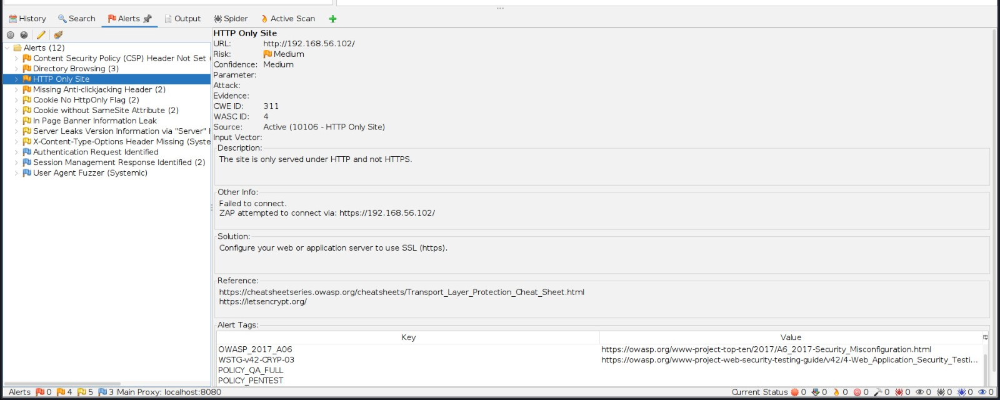
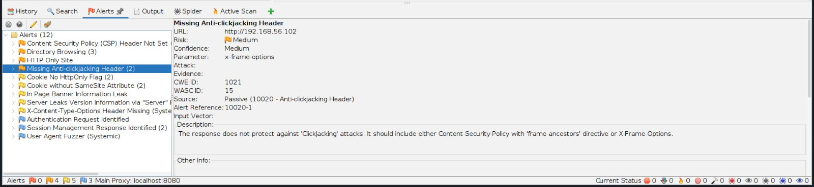
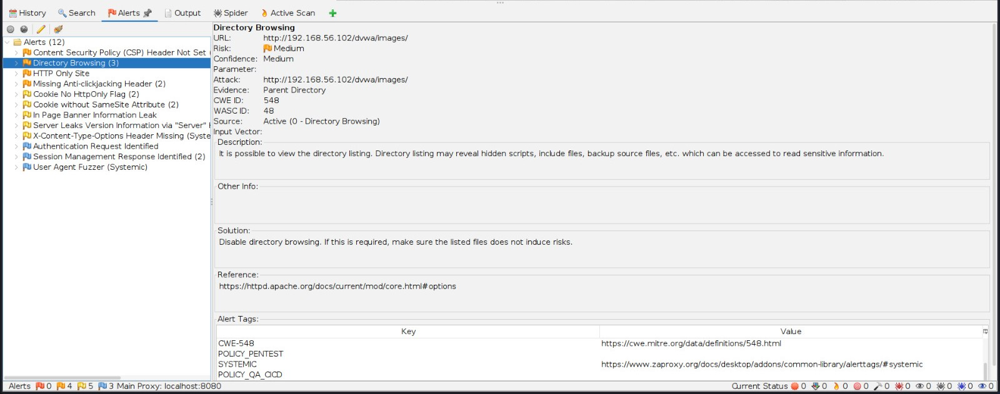
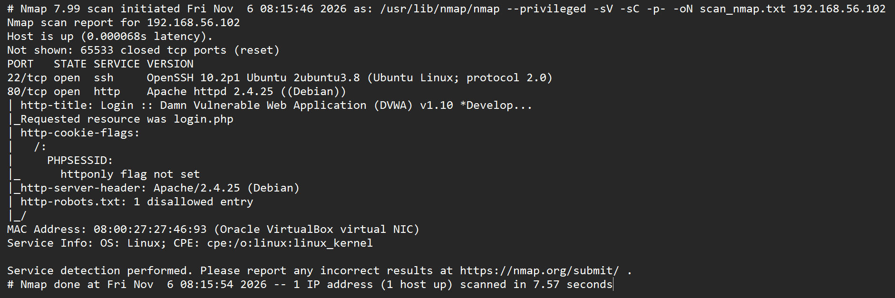

# Vulnerability Assessment & Penetration Test (VAPT) Report

**Target:** DVWA (Damn Vulnerable Web Application) hosted on Ubuntu Server  
**Target IP:** `192.168.56.102`  
**Tools Used:** Nmap v7.99, OWASP ZAP v2.17.0  
**Date:** 11/06/2026  
**Analyst:** Nantenaina Mickaël Rakotondramanana  
**Classification:** Confidential  

---

## 1. Executive Summary

A security assessment was conducted on a web application (DVWA) hosted on an Ubuntu server. The assessment aimed to identify potential vulnerabilities and configuration flaws that could be exploited by an attacker.

The scan revealed **4 main findings**: one infrastructure misconfiguration (exposed SSH), and three web application misconfigurations (Missing HTTPS, Clickjacking vulnerability, and Directory Browsing). 

*Note: As this was an unauthenticated scan (performed without logging into the application), vulnerabilities requiring authentication (such as SQL Injection or Stored XSS within the app) were not tested.*

### Risk Matrix

| Severity | Count | Findings |
| :--- | :--- | :--- |
| **High** | 0 | - |
| **Medium** | 3 | HTTP Only Site, Missing Anti-clickjacking, Directory Browsing |
| **Low** | 1 | Cookie No HttpOnly Flag |
| **Info** | 2 | Server Version Disclosure, SSH Exposure |

---

## 2. Scope & Methodology

- **Scope:** The assessment was limited to the target IP `192.168.56.102` and its exposed services.
- **Methodology:** 
  1. **Reconnaissance:** Nmap was used for port scanning and service version detection.
  2. **Web Application Scanning:** OWASP ZAP was used to perform automated spidering and active scanning of the web application to identify misconfigurations and missing security headers.

---

## 3. Technical Findings

### 3.1 Missing Transport Layer Security (HTTP Only)

- **Severity:** Medium
- **OWASP Mapping:** A02:2021 - Cryptographic Failures
- **Description:** The application is served entirely over HTTP (Port 80) without HTTPS encryption. All communications, including potential login credentials, are transmitted in cleartext over the network.
- **Evidence:**
 
- **Remediation:** Configure the web server to use an SSL/TLS certificate and enforce HTTPS.

  *Apache Fix:* Use `mod_ssl` and redirect all HTTP traffic to HTTPS via `.htaccess`:
  ```apache
  RewriteEngine On
  RewriteCond %{HTTPS} off
  RewriteRule ^(.*)$ https://%{HTTP_HOST}%{REQUEST_URI} [L,R=301]
  ```
### 3.2 Missing Anti-clickjacking Header
- **Severity:** Medium
- **OWASP Mapping:** A05:2021 - Security Misconfiguration
- **Description:** The application does not set the `X-Frame-Options` HTTP header. This allows the page to be embedded in an `<iframe>` on a malicious site, enabling CLickjacking attacks where users are tricked into clicking hidden elements.
- **Evidence:**
  
- *Remediation:** Add the `X-Frame-Options` header to the server configuration.
  *Apache Fix:*
  ```apache
  Header always set X-Frame-Options "SAMEORIGIN"
  ```
### 3.3 Directory Browsing Enabled
- **Severity:** Medium
- **OWASP Mapping:** A01:2021 - Broken Access Control
- **Description:** The web server displays a list of files for directories lacking an index file (e.g., `/dvwa/images`). This allows attackers to enumerate hidden files, backup scripts, or sensitive information.
- **Evidence:**
  
- **Remediation:** Disable directory listing at the web server level.
  Apache Fix : Add this to the `.htaccess` fle or virtual host configuration:
  ```apache
  Options -Indexes
  ```

## 3.4 Cookie No HttpsOnly Flag
- **Severity:** Low
- **OWASP Mapping:** A05:2021 - Security Misconfiguration
- **Description:** The session cookie (`PHPSESSID`) is set without the `HttpOnly` flag. If a Cross-Site Scripting (XSS) vulnerability exists, an attacker could use Javascript to steal the cookie and hijack the session.
- **Evidence:**
  
- **Severity:** Low/Informational
- **Description:** Nmap revealed that port 80 is running `Apache httpd 2.4.25 (Debian)` and port 22 is running `openSSH`.Exposing exact software versions allows attackers to search for known CVEs (Common Vulnerabilities and Exposures) specific to those versions.
- **Evidence:**
  
- **Remediation:** Hide server signatures.
  Apache fix:
  ```apache
  ServerTokens Prod
  ServerSignature Off
  ```

## 3.6 Infrastructure Exposure: SSH (Nmap)
- **Severity:**: Medium
- **Description:** Port 22 (SSH) is exposed on the network. If weak passwords or default configurations are used, this service is vulnerable to brute-force attacks.
- **Remediation:**
    1. Disable password authentication and enforce SSH Keys.
    2. Use a tool like `Fail2Ban` to block IPs after multiple failed login attempts.
    3. Restrict access to Port 22 via firewall to trusted IP ranges only.
# 4. Strategic Recommendations
  1. **Immediate (0-48h):** Implement HTTPS and add the `X-Frame-Options` header.
  2. **Short-term (1-2 weeks):** Disable directory browsing and patch the web server to the latest stable version.
  3. **Long-term (Continuous):** Set up a Web Application Firewall (WAF) like ModSecurity, and conduct regular vulnerability scans.

# 5. Disclaimer
This assessment was conducted in a controlled lab environment. No unauthorized testing was performed. This findings are based on automated scans and may not cover all potential vulnerabilities, especially those requiring authenticated access.

End of Report
